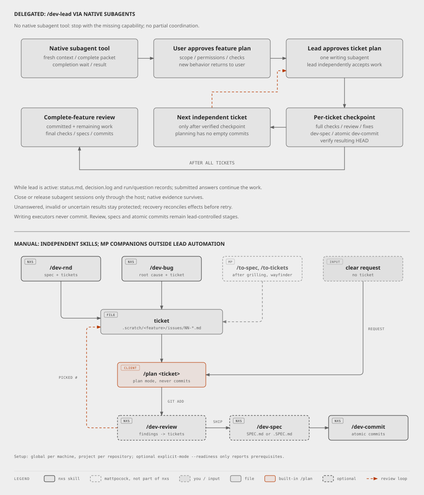
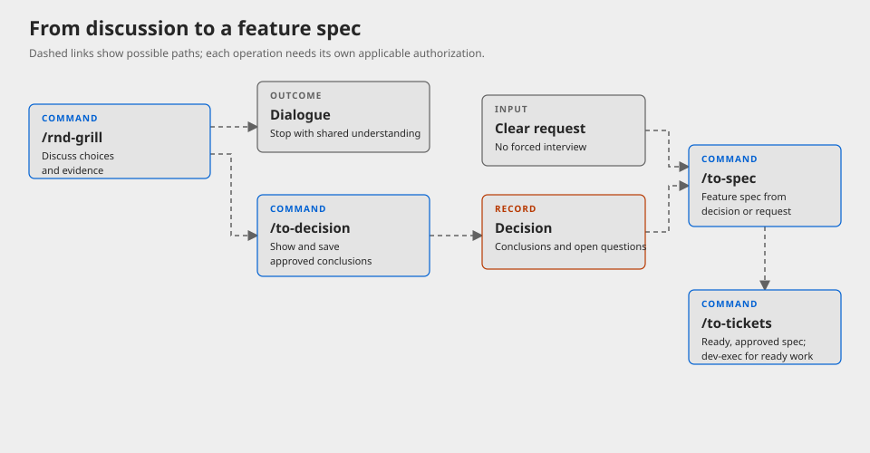
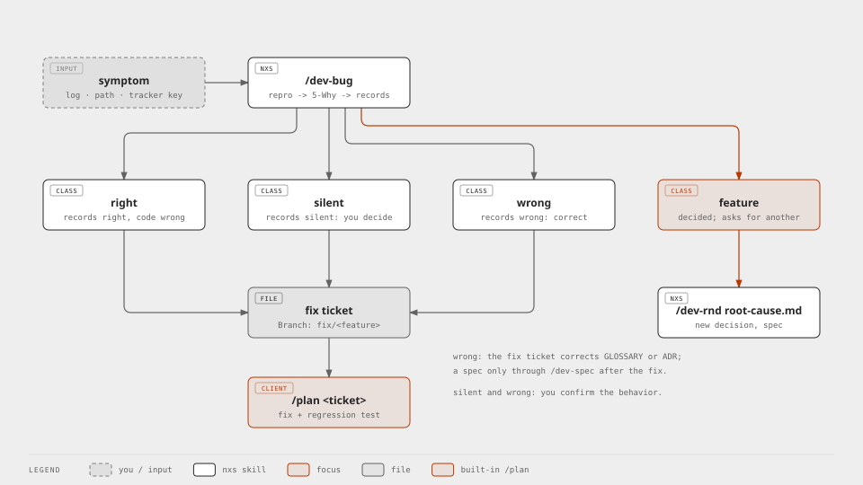
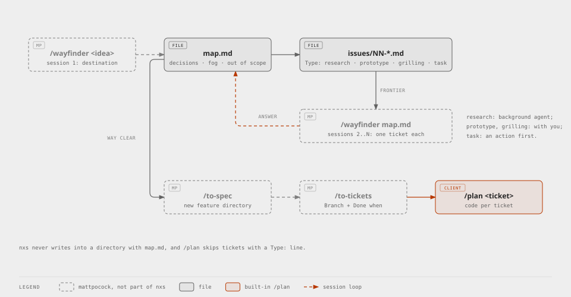
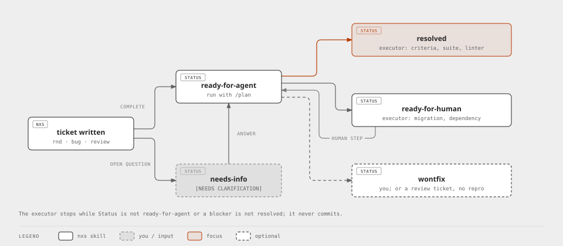
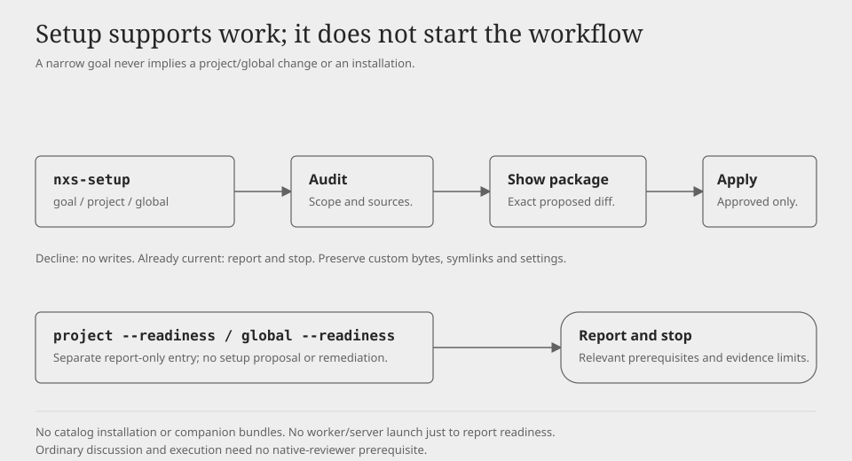
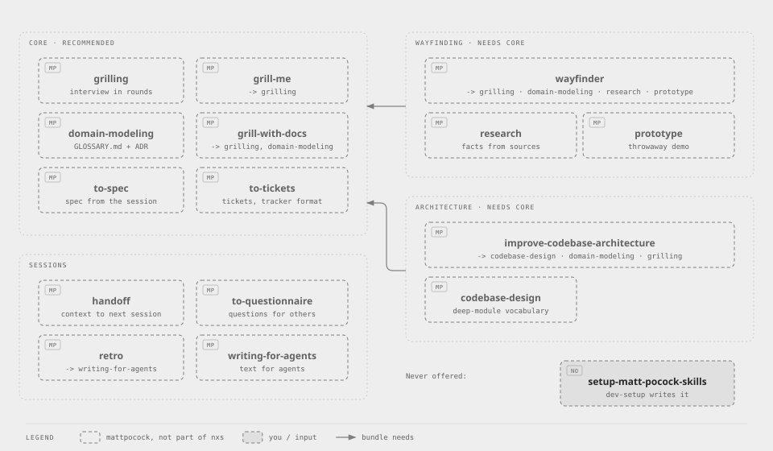
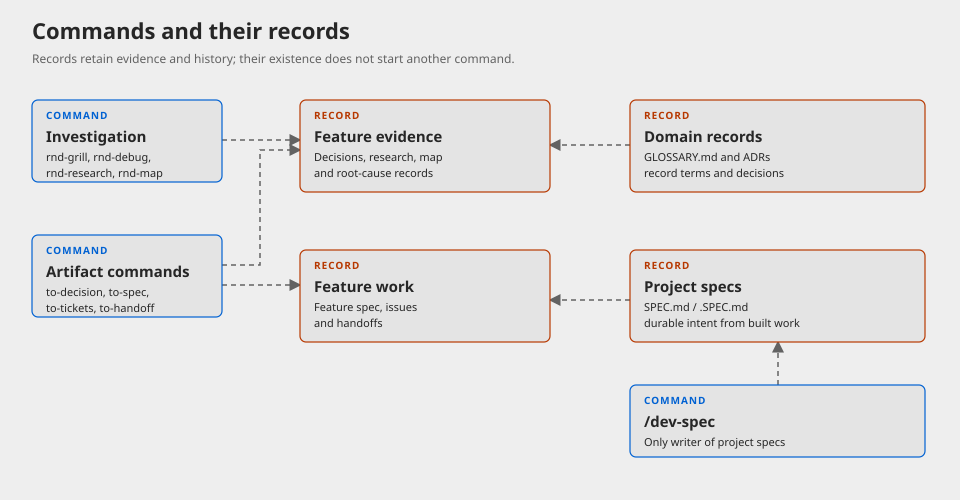

# nxs

Development skills for coding agents, from investigation and decisions through execution, review, project specs and commits. Commands are independently invoked; an artifact or approval for one stage does not start the next. The source catalog is additive and the final route and installation cutover has not happened. [Client scenarios](tests/client-scenarios.md) distinguish observed behavior from unverified routes.

<picture>
  <source media="(prefers-color-scheme: dark)" srcset="docs/images/workflow-dark.svg">
  
</picture>

## Target catalog

These 19 commands are in the source tree. Presence and shell checks do not prove registration or live behavior in a client. Invoke explicitly using `/` in supported clients or `@` in OpenCode; `dev-commit` also accepts a direct commit request. Read the linked contract for inputs, approvals and stops.

### Investigation and decisions

| Command | Purpose |
| --- | --- |
| [rnd-map](skills/rnd-map/SKILL.md) | Map an uncertain goal into linked decision questions and dependencies. |
| [rnd-grill](skills/rnd-grill/SKILL.md) | Discuss an idea or plan through evidence-backed choices, ending in dialogue or a request to save. |
| [rnd-research](skills/rnd-research/SKILL.md) | Investigate a question and save attributable findings and limits without making the user's decision. |
| [rnd-prototype](skills/rnd-prototype/SKILL.md) | Test one hypothesis with a retained temporary prototype and an evidence-backed verdict. |
| [rnd-debug](skills/rnd-debug/SKILL.md) | Investigate a failure and save a confirmed root cause or the missing evidence. |
| [rnd-audit](skills/rnd-audit/SKILL.md) | Survey a project and rank evidence-backed architecture opportunities. |
| [rnd-design](skills/rnd-design/SKILL.md) | Design an explicitly selected module or seam and save an agreed interface decision. |

### Artifacts

| Command | Purpose |
| --- | --- |
| [to-decision](skills/to-decision/SKILL.md) | Show and explicitly save approved conclusions or unfinished discussion. |
| [to-spec](skills/to-spec/SKILL.md) | Turn a saved decision or clear request into a feature spec with questions and acceptance checks. |
| [to-tickets](skills/to-tickets/SKILL.md) | Create or revise executable tickets from an approved feature spec, eligible confirmed cause or selected review findings. |
| [to-questionnaire](skills/to-questionnaire/SKILL.md) | Prepare recipient-specific questions for missing facts or decisions without sending them. |
| [to-handoff](skills/to-handoff/SKILL.md) | Save resumable context, separating accepted, open and unverified state. |

### Development

| Command | Purpose |
| --- | --- |
| [dev-exec](skills/dev-exec/SKILL.md) | Execute a ticket or clear request in the current session through an approved plan and checks. |
| [dev-review](skills/dev-review/SKILL.md) | Review changes and verify findings; `--to-tickets` saves a selection for a separate ticket step. |
| [dev-spec](skills/dev-spec/SKILL.md) | Record durable project specs from built work. |
| [dev-commit](skills/dev-commit/SKILL.md) | Commit existing changes in atomic groups. |

### Support and coordination

| Command | Purpose |
| --- | --- |
| [nxs-lead](skills/nxs-lead/SKILL.md) | Coordinate entrusted work using bounded native subagents and independently checked handoffs. |
| [nxs-setup](skills/nxs-setup/SKILL.md) | Audit a setup goal and apply an approved package, or report readiness. |
| [nxs-retro](skills/nxs-retro/SKILL.md) | Review one session and save evidence-based improvement proposals. |

## Retained legacy routes and cutover

Four additional source entries remain: [dev-rnd](skills/dev-rnd/SKILL.md) combines feature shaping and ticket creation; [dev-bug](skills/dev-bug/SKILL.md) diagnoses and can create a fix ticket; [dev-lead](skills/dev-lead/SKILL.md) coordinates the retained route; [dev-setup](skills/dev-setup/SKILL.md) retains its global/project setup and companion bundle offer. Ordinary `dev-review` also retains its ticket-creation route. These are not the 19-command target catalog.

`to-tickets` currently retains `/plan` as its generated executor handoff. `dev-exec` is a separate candidate; existing `/plan` tickets remain usable. Legacy routes and callers stay until their replacement gates pass. No source change updates installed copies. Before a future replacement, identify the installed path and provenance, preserve user changes, verify the replacement and registration, and obtain applicable authorization. The same names `to-spec`, `to-tickets` and `to-questionnaire` can identify other implementations; check the installed path rather than assuming provenance.

## Using the stages

A possible independent route is `rnd-grill` -> `to-decision` -> `to-spec` -> `to-tickets`; each step needs an appropriate request and its own applicable approval. A clear request can go directly to `dev-exec`, which presents a plan before implementation. Review, recording built project intent and committing are separate steps. The retained `/plan` handoff is described above.

<picture>
  <source media="(prefers-color-scheme: dark)" srcset="docs/images/grill-dark.svg">
  
</picture>

For a failure, `rnd-debug` records evidence and an eligible confirmed cause can be passed to `to-tickets`; uncertain causes do not produce ready work. The retained `dev-bug` route has its own ticket behavior.

<picture>
  <source media="(prefers-color-scheme: dark)" srcset="docs/images/bug-dark.svg">
  
</picture>

`rnd-map` records linked decision questions. Its decision tickets are not implementation tickets; resolving a map does not authorize implementation. Research and prototypes can inform a decision, and a later feature spec and tickets require their own scope.

<picture>
  <source media="(prefers-color-scheme: dark)" srcset="docs/images/wayfinder-dark.svg">
  
</picture>

Ticket status and executor evidence are distinct from coordinator acceptance and commit checkpoints. See [ticket rules](skills/to-tickets/references/ticket.md) and [execution](skills/dev-exec/SKILL.md).

<picture>
  <source media="(prefers-color-scheme: dark)" srcset="docs/images/ticket-status-dark.svg">
  
</picture>

## Coordination

`nxs-lead` is an additive coordinator. It delegates bounded work through the selected client's native subagent facility, waits for results and independently checks them. Ordinary mode relays substantive decisions; guarded auto requires explicit selection and approvals described in its [contract](skills/nxs-lead/SKILL.md). Native permission enforcement is client-dependent. Recorded Codex and OpenCode observations are limited cases; Claude Code, guarded auto and full coordinated workflows remain unverified. The retained `dev-lead` route has its own [contract](skills/dev-lead/SKILL.md).

## Setup and installation

`nxs-setup` supports a specific goal, project or global setup, and report-only readiness. It audits first, shows a coherent proposal and applies the approved package. It does not offer or install companion bundles; its [capability map](skills/nxs-setup/references/capabilities.md) describes source coverage, not registration. Setup and upgrade behavior are not live verified.

<picture>
  <source media="(prefers-color-scheme: dark)" srcset="docs/images/setup-dark.svg">
  
</picture>

<picture>
  <source media="(prefers-color-scheme: dark)" srcset="docs/images/bundles-dark.svg">
  
</picture>

The skills CLI can install selected source skills, for example `npx skills@latest add -g Villhard/nxs`, and update installed skills with `npx skills@latest update -g`. The new catalog's clean and existing installation paths, collision handling and native registration have not passed the live cutover gate. Inspect installed paths and provenance before running either command; do not assume a same-name skill can be replaced safely.

## Artifacts

Feature records typically live under `.scratch/<feature-slug>/`: decisions, research, feature specs, tickets and handoffs retain their own evidence and history. Existing paths take precedence over defaults. Project `SPEC.md` or private `.SPEC.md` records built intent; `dev-spec` is its only writer. Glossary and ADRs record domain terms and decisions.

<picture>
  <source media="(prefers-color-scheme: dark)" srcset="docs/images/artifacts-dark.svg">
  
</picture>

[CONTRIBUTING.md](CONTRIBUTING.md) documents source conventions and checks. [CHANGELOG.md](CHANGELOG.md) records history.
