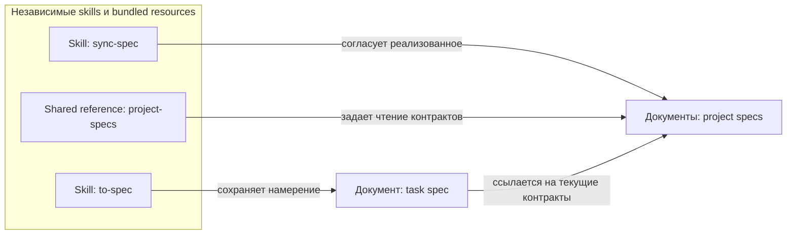

# nxs

## Цель

Самостоятельные skills для явных ограниченных намерений coding agents: от обсуждения решения до проверенной реализации.

## Архитектура

Skills из [каталога](README.md#какой-скилл-выбрать) устанавливаются независимо. Каждый skill содержит собственные ресурсы; общие references распространяются одинаковыми bundled copies от [владельца](CONTRIBUTING.md#структура). Зависимости от чужой установки, runtime и автоматического координатора нет.

Структурный обзор записи и чтения specs, не runtime-схема и не порядок вызовов:

[to-spec](skills/to-spec/SKILL.md) владеет task specs; правила чтения project specs принадлежат [shared reader](skills/sync-spec/references/project-specs.md), распространяемому по правилам bundled copies выше. Отдельных модульных project specs нет; узлы схемы не требуют создания пустых документов.

Спека задачи и tickets хранят намерение и причины, не доказательство реализации. Живые project `SPEC.md`/`.SPEC.md` описывают реализованные контракты и существенное обоснование; их writer - [sync-spec](skills/sync-spec/SKILL.md). История tracked SPEC хранится в Git. Отдельного ADR writer нет; существующие документы не мигрируются.

Прочая документация проекта читается как релевантный контекст, без отдельной обязательной стадии или обслуживания со стороны nxs. При чтении учитываются принятые термины, существенные противоречия показываются с источниками. Чтение не расширяет разрешенный охват записи.

Project specs читаются от корневой к ближайшей, затем - specs владельцев затронутых или используемых контрактов. Продолжение по связям нужно только для понимания этих контрактов, не для обхода всего графа. Выбранная историческая или staged-only версия сохраняется и для связанных источников. Учет прочитанных путей и версий ограничивает обход циклов; навигационные циклы допустимы и не являются зависимостями исполнения tickets.

Спеки задач по умолчанию хранятся в `.scratch/<feature-slug>/spec.md`, tickets - в `.scratch/<feature-slug>/issues/<NN>-<slug>.md`. Это локальные Markdown records без предварительной настройки. Явное локальное назначение важнее default; существующие документы сохраняются на месте, без принудительного переноса.

Явно переданный внешний источник читается как evidence, но не становится назначением записи. Недоступный источник останавливает затронутую операцию; один идентификатор без конкретного доступного источника или локального пути не разрешается автоматически и не заменяется новой записью.

## Границы

- Каждый вызов ограничен выбранным намерением и данным согласием; следующая команда автоматически не запускается.
- [dev-exec](skills/dev-exec/SKILL.md) принимает один готовый ticket. До выбора ветки и продуктовых правок он проверяет границу результата, сохраненное исключение размера при необходимости и доступность собственной приемки. Недоступная проверка или разрастание scope останавливают работу с сохранением дерева, index, проверенных commits и описанного по участкам остатка. Входной status gate сохраняется: согласие само по себе не разблокирует `ready-for-human`. Переразбиение и последующее исполнение требуют отдельных явных вызовов. Неизвестный выбор ветки согласуется и сохраняется; законченные шаги проверяются и безопасно коммитятся. `Do not commit` останавливает работу; непроверенная приемка оставляет ticket открытым. Review, sync-spec и push автоматически не запускаются.
- Чужие данные, история и index сохраняются. [Процедура коммита](skills/dev-commit/references/commit-format.md) определяет безопасный staging и остановки, включая mixed paths.
- [dev-review](skills/dev-review/SKILL.md) использует двух независимых native reviewers Standards/Spec с одинаковым закрепленным охватом committed/staged/unstaged/untracked. Подтвержденное отсутствие spec дает skipped, не pass; недоступный reviewer или изменение охвата - incomplete, без single-agent fallback. Review и sync-spec не подменяют выбранную историческую версию рабочим файлом.
- Source edits не публикуют изменения и не меняют установки, пользовательские records, Git settings или внешние сервисы. Согласие на запись относится только к выбранной цели; неизвестный эффект сначала проверяется чтением.

## Контракты

[to-spec](skills/to-spec/SKILL.md) при согласованном изменении архитектуры сохраняет затронутое to-be с необходимым окружением; на текущее состояние ссылается через project specs, не копирует весь as-is. Без архитектурного изменения новая схема не требуется. Ссылки на действительно связанные задачи поясняют отношение, но не заменяют `Blocked by` и не разрешают менять связанные records.

[sync-spec](skills/sync-spec/SKILL.md) при разрешенном создании или содержательном обновлении project spec приложения поддерживает обзор реализованного по умолчанию, включая обновление неархитектурного контракта; актуальный обзор переиспользуется. Для модульной spec схема нужна при существенной внутренней структуре или взаимодействиях. Отсутствие схемы само по себе не разрешает запись или создание spec. Точечное исправление соседней ссылки не требует добавлять обзор и менять незатронутые контракты.

Схемы обоих writers - обычный Mermaid `flowchart` внутри существующих разделов с понятными типами элементов, реальными границами и подписанными отношениями. Семантика C4 не требует всех уровней и не превращает каталоги в containers/components; для неподходящей C4-модели используется явно названный структурный обзор без вымышленных runtime boundaries. Схема дополняет текст, а существенное противоречие разбирается по источникам до затронутой записи. Проверка реальным renderer отделена от утверждений о поддержке конкретными клиентами.

Навигация работает через обычные Markdown-ссылки рядом со схемой независимо от Mermaid-кликов. Project specs связывают существующих родителей, дочерние specs и владельцев используемых контрактов, сохраняя факт у одного владельца; task specs ссылаются на применимые project specs и связанные задачи. Используются фактические имена `SPEC.md`/`.SPEC.md`; отсутствующая spec не требует заглушки, модульная допустима без корневой. При переносе пути `sync-spec` обновляет затронутые родительские и входящие ссылки, в том числе вне каталога модуля, но не мигрирует несвязанные specs и ручные дополнения. Эти правила не запускают массовое обновление существующих records; повтор неизменного входа не дублирует схемы и ссылки.

[Контракт ticket](skills/to-tickets/references/ticket.md) задает один наблюдаемый результат, принимаемый после blockers без будущего зависимого ticket. Реализация и необходимые проверки одного поведения составляют единый контракт; число критериев не требует дробления или исключения. Реально крупный неделимый scope требует сохраненных конкретного основания и явного согласия именно на него. Собственная приемка компонента не откладывается до интеграции; интеграционный ticket имеет свой сквозной результат, а не остаток незавершенных обязательств компонентов.

Новый record содержит `**What to build:**`, `**Blocked by:**`, необязательный `**Branch:**`, `**Status:**`, обязательную `## Приемка` с checkboxes, `## Условия завершения` и `## Комментарии` для решений и истории. Необязательная `## Предпосылки проверки` описывает условия конкретной приемки, не подтверждает доступ сама по себе; старые records читаются без миграции. До создания будущего ресурса проверяются разрешение и возможность его создать, а не его наличие. Blockers содержат номера и ссылки на реальные локальные файлы; без зависимостей - `None (can start immediately)`. Нумерация пустого `issues/` начинается с `01`, новые номера идут после максимального существующего, новые blockers предшествуют новым зависимым.

Только явно согласованное [переразбиение](skills/to-tickets/references/resplit.md) открытого ticket меняет его scope, критерии и граф: один результат сохраняет ID, прочие получают новые; прежняя цель, все критерии с отметками, ручная история и пределы доказательств сохраняются. Остаток распределяется по конкретным участкам, включая разные hunks одного файла, с исключением чужого и human-blocker при неизвестном владении. Входящие зависимости согласованного набора указывают на реальных владельцев; меньший старый ID может зависеть от большего нового при ацикличном графе. Снимается только устраненная scope-причина, не другие human-blockers. Частичная или неподтвержденная запись восстанавливается по фактическим records и прежней карте без дубликатов; полный повтор - no-op. Обычный повтор не меняет scope, закрытые tickets не переоткрываются, само разбиение не означает `resolved`.

Пять статусов - `ready-for-agent`, `needs-info`, `ready-for-human`, `resolved`, `wontfix`. Исполняется только точно указанный `ready-for-agent` ticket; каждый blocker должен быть однозначно `resolved`, а его нужный результат - проверен в выбранном worktree. `wontfix` не удовлетворяет зависимость. Критерии отмечаются и `resolved` выставляется только после всей приемки и обязательных проверок; следующий ticket автоматически не исполняется.

## Известные ограничения

Source-agent smoke на disposable local fixtures проверяет ограниченные сценарии подготовки, остановок, исполнения и файлового восстановления. Это не доказывает native регистрацию, live compatibility всех клиентов или непрерывный multi-turn recovery: новый agent на тех же records подтверждает только файловое восстановление. Prompt-only ограничения не являются host sandbox; локальные signed fixtures не доказывают RSA/JWKS или browser OAuth flow.

Частный `.SPEC.md` существует только в рабочем дереве и теряется при fresh clone или `git clean -x`. Комментарии ticket дают контекст продолжения, но не гарантируют session recovery между клиентами.

## Обоснование

Разделение намерений не смешивает подготовку с записью реализованного. Независимая установка не требует координатора; проверенные законченные шаги дают наблюдаемый результат без обязательного TDD для любой задачи. Две review-оси сохраняют независимость требований и стандартов без многослойной оркестрации.

Собственная приемка ограничивает scope лучше счетчиков файлов, критериев или commits: несколько обязательных проверок могут защищать один неделимый контракт. Внутренние атомарные commits сохраняют проверенное продвижение, но не заменяют разбиение самостоятельных результатов.
