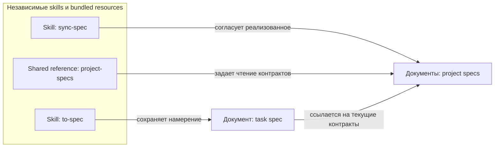
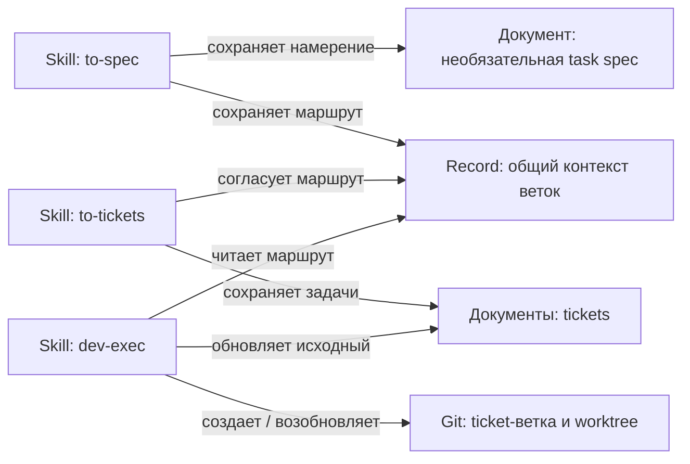

# nxs

## Цель

Самостоятельные skills для явных ограниченных намерений coding agents: от обсуждения решения до проверенной реализации.

## Архитектура

Skills из [каталога](README.md#какой-скилл-выбрать) устанавливаются независимо. Каждый skill содержит собственные ресурсы; общие references распространяются одинаковыми bundled copies от [владельца](CONTRIBUTING.md#структура). Зависимости от чужой установки, runtime и автоматического координатора нет.

Структурный обзор записи и чтения specs, не runtime-схема и не порядок вызовов:

[to-spec](skills/to-spec/SKILL.md) владеет task specs; правила чтения project specs принадлежат [shared reader](skills/sync-spec/references/project-specs.md), распространяемому по правилам bundled copies выше. Отдельных модульных project specs нет; узлы схемы не требуют создания пустых документов.

Структурный обзор подготовки общего маршрута и изолированного исполнения tickets, не автоматическая цепочка вызовов:

Владельцы контрактов: [общий контекст веток](skills/to-tickets/references/branch-context.md), [ticket](skills/to-tickets/references/ticket.md) и [рабочее место исполнения](skills/dev-exec/references/workspace.md). Skills подготовки сохраняют маршрут и намерение; исполнитель использует их по отдельному явному вызову.

Спека задачи и tickets хранят намерение и причины, не доказательство реализации. Живые project `SPEC.md`/`.SPEC.md` описывают реализованные контракты и существенное обоснование; их writer - [sync-spec](skills/sync-spec/SKILL.md). История tracked SPEC хранится в Git. Отдельного ADR writer нет; существующие документы не мигрируются.

Прочая документация проекта читается как релевантный контекст, без отдельной обязательной стадии или обслуживания со стороны nxs. При чтении учитываются принятые термины, существенные противоречия показываются с источниками. Чтение не расширяет разрешенный охват записи.

Project specs читаются от корневой к ближайшей, затем - specs владельцев затронутых или используемых контрактов. Продолжение по связям нужно только для понимания этих контрактов, не для обхода всего графа. Выбранная историческая или staged-only версия сохраняется и для связанных источников. Учет прочитанных путей и версий ограничивает обход циклов; навигационные циклы допустимы и не являются зависимостями исполнения tickets.

Спеки задач по умолчанию хранятся в `.scratch/<feature-slug>/spec.md`, tickets - в `.scratch/<feature-slug>/issues/<NN>-<slug>.md`. Это локальные Markdown records без предварительной настройки. Явное локальное назначение важнее default; существующие документы сохраняются на месте, без принудительного переноса.

Каталог работы объединяет необязательную task spec, tickets и единственный общий контекст веток; работа без `to-spec` поддерживается. Общие настройки не копируются в spec/tickets. Явные Markdown-ссылки разрешаются от содержащего record; нестандартное назначение важнее default, отсутствующий явно связанный источник не заменяется новым default.

Явно переданный внешний источник читается как evidence, но не становится назначением записи. Недоступный источник останавливает затронутую операцию; один идентификатор без конкретного доступного источника или локального пути не разрешается автоматически и не заменяется новой записью.

## Границы

- Каждый вызов ограничен выбранным намерением и данным согласием; следующая команда автоматически не запускается.
- [dev-exec](skills/dev-exec/SKILL.md) принимает один точно выбранный готовый ticket. До создания рабочего места и продуктовых правок он проверяет границу результата, сохраненное исключение размера при необходимости и доступность собственной приемки. Недоступная проверка или разрастание scope останавливают работу с сохранением дерева, index, проверенных commits и описанного по участкам остатка. Согласие само по себе не разблокирует `ready-for-human`; переразбиение и последующее исполнение требуют отдельных явных вызовов. `Do not commit` останавливает работу, непроверенная приемка оставляет ticket открытым; законченные шаги проверяются и безопасно коммитятся.
- По [контракту рабочего места](skills/dev-exec/references/workspace.md) отсутствующая общая spec-ветка в `feature` создается от актуального локального HEAD точной согласованной конечной цели, без fetch и произвольного текущего HEAD. Существующая общая ветка не пересоздается и не перемещается. Новая ticket-ветка и отдельный worktree вне исходного дерева создаются от актуального локального HEAD интеграционной ветки. Продукт и commits принадлежат ticket-worktree; история и статусы записываются только в исходный ticket, даже при наличии tracked копии в новом дереве. Исходное дерево, index и чужие данные не переключаются и не переносятся.
- Имя ветки и ancestry не доказывают владение рабочим местом. Конфликт, недоступная база или неясный эффект требуют остановки и чтения реального состояния, без force/reset, автоматического суффикса или нового места для обхода. Независимые явные вызовы могут исполняться параллельно в разных worktrees; автоматического координатора нет, `in-progress` не lock/lease/timeout для одного ticket.
- `resolved` означает всю приемку данного ticket, не одобрение review, merge, завершение фичи или будущую совместимость параллельных результатов. Исполнение не запускает автоматически review, merge, fetch/rebase, push, PR/MR, следующий ticket или skill.
- Чужие данные, история и index сохраняются. [Процедура коммита](skills/dev-commit/references/commit-format.md) определяет безопасный staging и остановки, включая mixed paths.
- [dev-review](skills/dev-review/SKILL.md) использует двух независимых native reviewers Standards/Spec с одинаковым закрепленным охватом committed/staged/unstaged/untracked. Подтвержденное отсутствие spec дает skipped, не pass; недоступный reviewer или изменение охвата - incomplete, без single-agent fallback. Review и sync-spec не подменяют выбранную историческую версию рабочим файлом.
- Source edits не публикуют изменения и не меняют установки, пользовательские records, Git settings или внешние сервисы. Согласие на запись относится только к выбранной цели; неизвестный эффект сначала проверяется чтением.

По [правилам охвата review](skills/dev-review/SKILL.md#охват-и-требования) источник выбирает один ticket либо всю фичу, не имя ветки. Явный ref приоритетен только при достаточном покрытии. Ticket-review охватывает исходный результат и доработку от доказанного исходного execution HEAD, не включает соседей общей базы автоматически. Feature-review использует доказанную общую границу всех выбранных результатов, не старт последнего ticket. Merge-base конечной цели допустим при доказанном происхождении и полном покрытии; `direct` требует состава и явных исключений. Неоднозначная или непокрывающая baseline останавливает review до запуска reviewers.

## Контракты

[to-spec](skills/to-spec/SKILL.md) при согласованном изменении архитектуры сохраняет затронутое to-be с необходимым окружением; на текущее состояние ссылается через project specs, не копирует весь as-is. Без архитектурного изменения новая схема не требуется. Ссылки на действительно связанные задачи поясняют отношение, но не заменяют `Blocked by` и не разрешают менять связанные records.

[sync-spec](skills/sync-spec/SKILL.md) при разрешенном создании или содержательном обновлении project spec приложения поддерживает обзор реализованного по умолчанию, включая обновление неархитектурного контракта; актуальный обзор переиспользуется. Для модульной spec схема нужна при существенной внутренней структуре или взаимодействиях. Отсутствие схемы само по себе не разрешает запись или создание spec. Точечное исправление соседней ссылки не требует добавлять обзор и менять незатронутые контракты.

Схемы обоих writers - обычный Mermaid `flowchart` внутри существующих разделов с понятными типами элементов, реальными границами и подписанными отношениями. Семантика C4 не требует всех уровней и не превращает каталоги в containers/components; для неподходящей C4-модели используется явно названный структурный обзор без вымышленных runtime boundaries. Схема дополняет текст, а существенное противоречие разбирается по источникам до затронутой записи. Проверка реальным renderer отделена от утверждений о поддержке конкретными клиентами.

Навигация работает через обычные Markdown-ссылки рядом со схемой независимо от Mermaid-кликов. Project specs связывают существующих родителей, дочерние specs и владельцев используемых контрактов, сохраняя факт у одного владельца; task specs ссылаются на применимые project specs и связанные задачи. Используются фактические имена `SPEC.md`/`.SPEC.md`; отсутствующая spec не требует заглушки, модульная допустима без корневой. При переносе пути `sync-spec` обновляет затронутые родительские и входящие ссылки, в том числе вне каталога модуля, но не мигрирует несвязанные specs и ручные дополнения. Эти правила не запускают массовое обновление существующих records; повтор неизменного входа не дублирует схемы и ссылки.

[Контракт ticket](skills/to-tickets/references/ticket.md) задает один наблюдаемый результат, принимаемый после blockers без будущего зависимого ticket. Реализация и необходимые проверки одного поведения составляют единый контракт; число критериев не требует дробления или исключения. Реально крупный неделимый scope требует сохраненных конкретного основания и явного согласия именно на него. Собственная приемка компонента не откладывается до интеграции; интеграционный ticket имеет свой сквозной результат, а не остаток незавершенных обязательств компонентов.

[Общий контекст веток](skills/to-tickets/references/branch-context.md) по умолчанию хранится в `<каталог работы>/branch.md`, но явное назначение имеет приоритет. Record содержит `Mode`, `Target branch` и только для `feature` - `Spec branch`; интеграционная ветка выводится из режима, отдельного настраиваемого поля нет. Default `feature` дает отдельную spec-ветку для интеграции tickets и конечную цель будущего общего PR/MR фичи с task spec. Только явный `direct` совмещает интеграционную и конечную цели, без spec-ветки и обещания единого PR/MR.

`to-spec` согласует и сохраняет общий контекст со ссылкой из task spec; `to-tickets` использует его либо согласует без обязательной task spec. Точные ticket-ветки показываются вместе с картой до записи и сохраняются после согласия; они отличаются от интеграционной и веток других новых tickets. Неизменные имена, режим и база не спрашиваются повторно; изменение решения или конфликт требуют отдельного согласования. Маршрут не выводится из текущего HEAD, имени каталога или предполагаемой `main`. Подготовка меняет только согласованные records, не Git.

Новый согласованный record содержит `**What to build:**`, `**Blocked by:**`, `**Branch context:**` с явной ссылкой на единый контекст, точную `**Branch:**`, `**Status:**`, обязательную `## Приемка` с checkboxes, `## Условия завершения` и `## Комментарии` для решений и истории. Несогласованный черновик не выдает ветки за согласованные; старые records читаются без автоматической миграции или fallback от текущего HEAD. Необязательная `## Предпосылки проверки` описывает условия конкретной приемки, не подтверждает доступ сама по себе. До создания будущего ресурса проверяются разрешение и возможность его создать, а не его наличие. Blockers содержат номера и ссылки на реальные локальные файлы; без зависимостей - `None (can start immediately)`. Нумерация пустого `issues/` начинается с `01`, новые номера идут после максимального существующего, новые blockers предшествуют новым зависимым.

Только явно согласованное [переразбиение](skills/to-tickets/references/resplit.md) открытого ticket меняет его scope, критерии и граф: один результат сохраняет ID, прочие получают новые; прежняя цель, все критерии с отметками, ручная история и пределы доказательств сохраняются. `in-progress` не переразбивается до отдельного перевода в другое допустимое открытое состояние; подготовка сама его не переводит. Общий контекст остается единым. Исходный результат сохраняет доказанные Branch/worktree, execution HEAD и commits; новые результаты получают согласованные отдельные ветки, не владение старым местом. Унаследованные OIDs остаются историей, не стартом нового исполнения.

Остаток распределяется по конкретным участкам, включая разные hunks одного файла, с фиксацией физического worktree, пути и staged/unstaged/untracked слоя. Чужое исключается, неизвестное владение оставляет human-blocker. Логическое назначение не переносит данные: остаток нового результата в старом месте требует отдельного решения и оставляет human-blocker. `Do not commit` и применимые ручные ограничения сохраняются у соответствующих владельцев; запрет коммита оставляет `ready-for-human`. Отдельный resume сверяет реальное место и остаток; само переразбиение не меняет продукт, Git или index.

Входящие зависимости согласованного набора указывают на реальных владельцев; меньший старый ID может зависеть от большего нового при ацикличном графе. Снимается только устраненная scope-причина, не другие human-blockers. Частичная или неподтвержденная запись восстанавливается по фактическим records и прежней карте без дубликатов; полный повтор - no-op. Обычный повтор не меняет scope; `to-tickets` и resplit не переоткрывают `resolved`/`wontfix` и не переразбивают их. Само разбиение не означает `resolved`.

Шесть статусов - `ready-for-agent`, `in-progress`, `needs-info`, `ready-for-human`, `resolved`, `wontfix`. Новое исполнение начинает один точно указанный `ready-for-agent` ticket: до Git-создания сохраняются `in-progress` и намерение, до продуктовых правок - фактическое место и execution HEAD в исходном ticket. Ошибка записи останавливает исполнение. Обычный вызов для `in-progress` ничего не меняет; только явный resume сверяет прежние refs/worktree, историю, эффекты и остаток без повторения доказанных commits. Аварийное прерывание оставляет `in-progress`, человеческий blocker дает `ready-for-human`.

Каждый blocker должен быть однозначно `resolved`, а его нужный результат - проверен именно в фактическом ticket-worktree, без автоматического merge/cherry-pick blocker. Ни `in-progress`, ни `wontfix` не удовлетворяют зависимость. Критерии отмечаются и `resolved` выставляется только после всей приемки и обязательных проверок.

Узкое исключение [dev-exec](skills/dev-exec/SKILL.md): только явная просьба исправить конкретные замечания review ticket-ветки разрешает тому же `resolved` ticket пройти `ready-for-agent`, `in-progress` и после повторной полной приемки снова `resolved`. Сохраняются история завершения, замечания, commits, прежние ветка/worktree и исторический исходный execution HEAD; HEAD нового исполнения записывается отдельно. `Do not commit` проверяется до любой записи о продолжении; остальные gates и human-blockers не обходятся. Обычный повтор `resolved`, обсуждение или review общей ветки ticket не переоткрывают. После review общей spec-ветки либо целевой в `direct` отдельный явный `to-tickets` создает новые согласованные fix-tickets на том же общем маршруте, не переоткрывая исходные.

## Известные ограничения

Source-agent smoke на disposable local fixtures проверяет ограниченные сценарии подготовки, остановок, исполнения и файлового восстановления. Это не доказывает native регистрацию, live compatibility всех клиентов или непрерывный multi-turn recovery: новый agent на тех же records подтверждает только файловое восстановление. Prompt-only ограничения не являются host sandbox; локальные signed fixtures не доказывают RSA/JWKS или browser OAuth flow.

Частный `.SPEC.md` существует только в рабочем дереве и теряется при fresh clone или `git clean -x`. Комментарии ticket дают контекст продолжения, но не гарантируют session recovery между клиентами.

## Обоснование

Разделение намерений не смешивает подготовку с записью реализованного. Независимая установка не требует координатора; проверенные законченные шаги дают наблюдаемый результат без обязательного TDD для любой задачи. Две review-оси сохраняют независимость требований и стандартов без многослойной оркестрации.

Собственная приемка ограничивает scope лучше счетчиков файлов, критериев или commits: несколько обязательных проверок могут защищать один неделимый контракт. Внутренние атомарные commits сохраняют проверенное продвижение, но не заменяют разбиение самостоятельных результатов.

Общая интеграционная ветка собирает результат для цельного review, ticket-worktrees изолируют независимое исполнение, а отдельное согласие на интеграцию сохраняет контроль пользователя.
